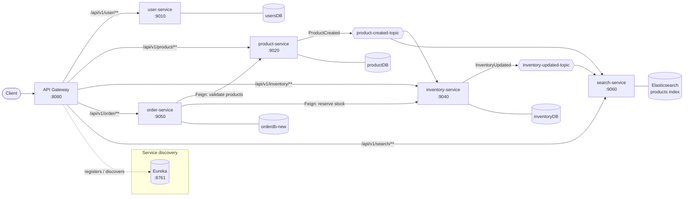
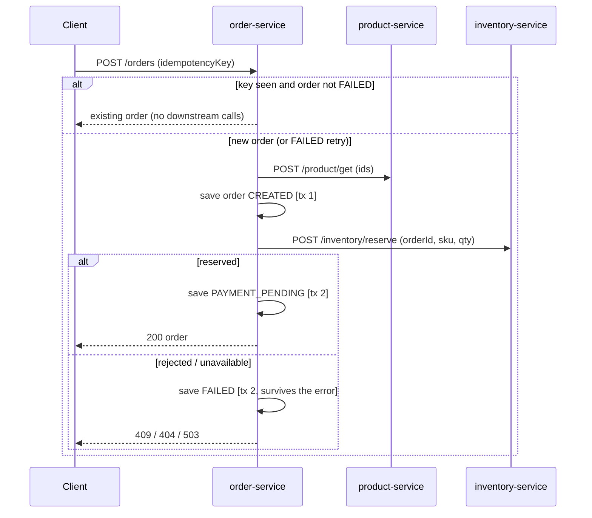

# Spring E-Commerce Microservices

An e-commerce backend built as Spring Boot microservices. It has service discovery, an API gateway, JWT auth, Kafka events between services, and Elasticsearch-backed product search.

**Stack:** Java 21 · Spring Boot 4.0 · Spring Cloud 2025.1 (Gateway, Eureka, OpenFeign) · Spring Data JPA / PostgreSQL · Apache Kafka · Elasticsearch 9 · ShedLock · JJWT

---

## Architecture



Every service registers with Eureka. The gateway routes by path (`lb://SERVICE-NAME`) and strips the `/api/v1` prefix.

### Order placement (current, synchronous)



Why the order isn't wrapped in one transaction: [ADR 001](docs/decisions/001-order-failure-state.md).

---

## Services

| Service | Port | Responsibility | Storage |
|---|---|---|---|
| `discovery-client` | 8761 | Eureka server | — |
| `api-gateway` | 8080 | Single entry point, path-based routing, tracing | — |
| `user-service` | 9010 | Signup, login, refresh token, JWT issuing (roles) | PostgreSQL `usersDB` |
| `product-service` | 9020 | Product catalog CRUD. Publishes `ProductCreated` | PostgreSQL `productDB` |
| `inventory-service` | 9040 | Stock levels. Reservations with 5-min expiry (`ReservationCleanupScheduler` + ShedLock). `@Version` optimistic locking. Publishes `InventoryUpdated` | PostgreSQL `inventoryDB` |
| `order-service` | 9050 | Order creation with idempotency key, price/discount validation, inventory reservation | PostgreSQL `orderdb-new` |
| `search-service` | 9060 | Indexes products from Kafka. Full-text and price-range search | Elasticsearch `products` |

### Main endpoints (service-local paths)

| Service | Endpoint |
|---|---|
| user | `POST /user/signup`, `POST /user/login`, `POST /user/refresh` |
| product | `POST /product`, `PUT /product`, `POST /product/get` (by ids) |
| inventory | `GET /inventory/{sku}`, `PUT /inventory/update`, `POST /inventory/reserve` |
| order | `POST /orders` |
| search | `GET /search/products?keyword=&minPrice=&maxPrice=&page=&size=` |

Through the gateway, prefix with `/api/v1`, e.g. `POST http://localhost:8080/api/v1/user/login`.

### Kafka events

| Topic | Producer | Consumers | Logical type id |
|---|---|---|---|
| `product-created-topic` | product-service | inventory-service, search-service | `productCreated` |
| `inventory-updated-topic` | inventory-service | search-service | `inventoryUpdated` |

Producers write a logical type id in the `__TypeId__` header (`spring.json.type.mapping`). Each consumer maps that id to **its own** event class in its own package, so no service depends on another service's class names.

---

## Running locally

### Prerequisites

- JDK 21
- PostgreSQL on `localhost:5432`, with databases `usersDB`, `productDB`, `inventoryDB`, `orderdb-new`
- Kafka on `localhost:9092`
- Elasticsearch on `localhost:9200`, with security disabled for local dev

> Docker Compose for the whole stack is coming in Task 2.

### Build

The repo is a Maven multi-module project with one parent POM. All versions are defined in the root `pom.xml`.

```bash
./mvnw -B verify            # build + test every module
./mvnw -pl order-service -am spring-boot:run   # run a single service
```

### Start order

1. `discovery-client` (Eureka at http://localhost:8761)
2. `user-service`, `product-service`, `inventory-service`, `order-service`, `search-service`
3. `api-gateway`

---

## Project layout

```
pom.xml                  root aggregator / parent (Boot 4.0.x, Cloud 2025.1.x, Java 21)
discovery-client/        Eureka server
api-gateway/             Spring Cloud Gateway (WebFlux)
user-service/            auth + JWT
product-service/         catalog, Kafka producer
inventory-service/       stock + reservations, Kafka producer/consumer
order-service/           orders, Feign clients
search-service/          Elasticsearch indexing/search, Kafka consumer
docs/decisions/          architecture decision records (ADRs)
```

---

## Known trade-offs

- **Duplicated JWT validation.** Each service has its own `JwtService` / `JwtAuthFilter`. Each service can validate tokens on its own and deploys independently, at the cost of duplicated code. If it grows, the alternative is a small shared `security-common` library, or validating only at the gateway and propagating identity headers.
- **Duplicated event classes.** Each consumer owns its copy of the event it consumes (e.g. `search_service.event.ProductCreatedEvent`), linked to the producer by a logical type id. Contracts can drift, but no service has to wait for a shared artifact release to deploy. A shared `common-events` module or a schema registry (Avro/Protobuf) is the next step if the number of events grows.
- **Synchronous order flow.** Order → inventory is a blocking Feign call. A crash between "order saved" and "status updated" can leave an order in `CREATED`. Reservations expire after 5 minutes, so stock isn't lost. An event-driven saga with a transactional outbox will replace this flow.
- **Secrets in config.** Local DB credentials and the JWT secret are currently in `application.properties`. They will be moved to environment variables.

## Known issues

- Gateway route `/api/v1/order/**` maps to `/order/**`, but order-service listens on `/orders`. Call order-service directly (`:9050/orders`) until the route is fixed.
