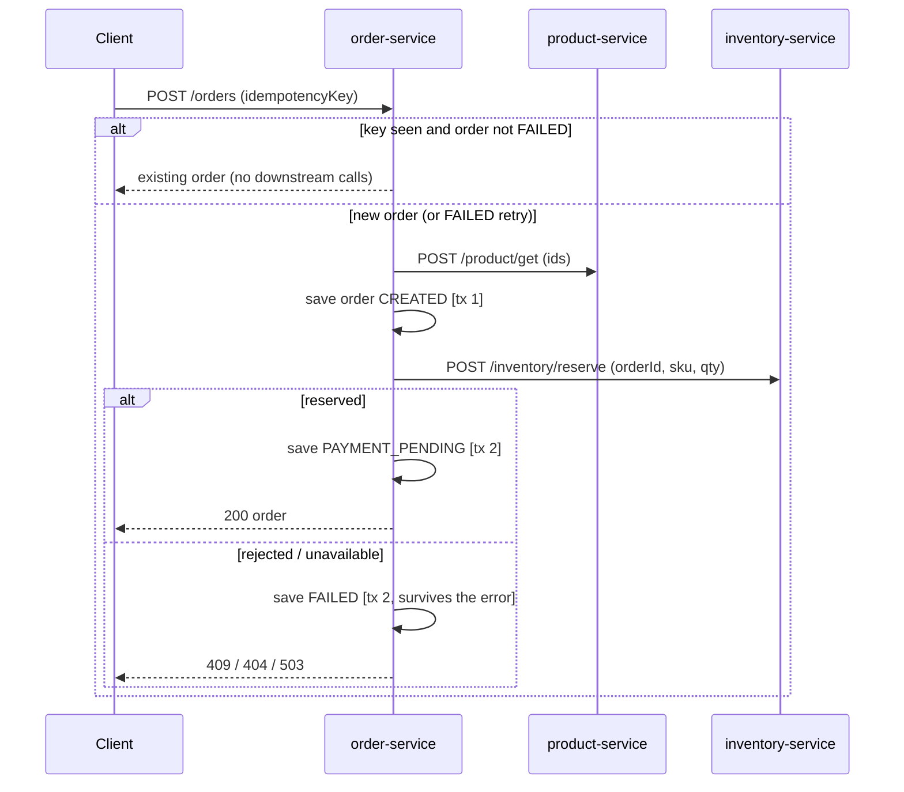

# Spring E-Commerce Microservices

An e-commerce backend built as Spring Boot microservices. It has service discovery, an API gateway, JWT auth, Kafka events between services, and Elasticsearch-backed product search.

**Stack:** Java 21 · Spring Boot 4.0 · Spring Cloud 2025.1 (Gateway, Eureka, OpenFeign) · Spring Data JPA / PostgreSQL · Apache Kafka · Elasticsearch 9 · ShedLock · JJWT

---

## Architecture


Every service registers with Eureka. The gateway routes by path (`lb://SERVICE-NAME`) and strips the `/api/v1` prefix.

### Order placement (current, synchronous)



Why the order isn't wrapped in one transaction: [ADR 001](docs/decisions/001-order-failure-state.md).

---

## Services

| Service | Port | Responsibility | Storage |
|---|---|---|---|
| `discovery-client` | 8761 | Eureka server | — |
| `api-gateway` | 8080 | Single entry point, path-based routing, tracing | — |
| `user-service` | 9010 | Signup, login, refresh token, JWT issuing (roles) | PostgreSQL `user_db` |
| `product-service` | 9020 | Product catalog CRUD. Publishes `ProductCreated` | PostgreSQL `product_db` |
| `inventory-service` | 9040 | Stock levels. Reservations with 5-min expiry (`ReservationCleanupScheduler` + ShedLock). `@Version` optimistic locking. Publishes `InventoryUpdated` | PostgreSQL `inventory_db` |
| `order-service` | 9050 | Order creation with idempotency key, price/discount validation, inventory reservation | PostgreSQL `order_db` |
| `search-service` | 9060 | Indexes products from Kafka. Full-text and price-range search | Elasticsearch `products` |

### Main endpoints (service-local paths)

| Service | Endpoint |
|---|---|
| user | `POST /user/signup`, `POST /user/login`, `POST /user/refresh` |
| product | `POST /product`, `PUT /product`, `POST /product/get` (by ids) |
| inventory | `GET /inventory/{sku}`, `PUT /inventory/update`, `POST /inventory/reserve` |
| order | `POST /orders` |
| search | `GET /search/products?keyword=&minPrice=&maxPrice=&page=&size=` |

Through the gateway, prefix with `/api/v1`, e.g. `POST http://localhost:8080/api/v1/user/login`.

### Kafka events

| Topic | Producer | Consumers | Logical type id |
|---|---|---|---|
| `product-created-topic` | product-service | inventory-service, search-service | `productCreated` |
| `inventory-updated-topic` | inventory-service | search-service | `inventoryUpdated` |

Producers write a logical type id in the `__TypeId__` header (`spring.json.type.mapping`). Each consumer maps that id to **its own** event class in its own package, so no service depends on another service's class names.

---

## Run with Docker (recommended)

One command starts everything: Postgres (one database and role per service), Kafka in KRaft mode, Elasticsearch, Eureka, the gateway and all services. Each service is built from a single multi-stage [`Dockerfile`](Dockerfile) (`--build-arg MODULE=<service>`) and runs as a non-root user on a JRE-only image.

```bash
cp .env.example .env          # then put real values in .env (JWT_SECRET must be >= 32 chars)
docker compose up --build -d
docker compose ps             # wait until every container is "healthy" (~1-2 min)
```

Give services ~30s after they turn healthy to register with Eureka. The dashboard is at http://localhost:8761.

| Host port | What |
|---|---|
| 8080 | API gateway (the only app entry point) |
| 8761 | Eureka dashboard |
| 15432 / 29092 / 19200 | Postgres / Kafka / Elasticsearch, for debugging from the host |

All host ports can be changed in `.env` if they clash with something already running. The full stack needs about 4 GB of RAM: give Docker Desktop at least 6 GB.

### End-to-end flow (all through the gateway)

```bash
G=http://localhost:8080/api/v1
J='Content-Type: application/json'

# 1. Sign up and log in
curl -s -X POST $G/user/signup -H "$J" \
  -d '{"name":"Demo User","email":"demo@example.com","password":"Passw0rd!"}'
TOKEN=$(curl -s -X POST $G/user/login -H "$J" \
  -d '{"email":"demo@example.com","password":"Passw0rd!"}' | jq -r '.data.accessToken')

# 2. Create a product. product-service publishes ProductCreated to Kafka.
curl -s -X POST $G/product -H "$J" -H "Authorization: Bearer $TOKEN" -d '{
  "name":"Trail Running Shoe","description":"Lightweight trail shoe","sku":"SHOE-TRAIL-01",
  "price":120.00,"discountPercent":10,"currency":"USD","category":"footwear","brand":"Acme",
  "totalQuantity":5,"imageUrls":["https://example.com/shoe.jpg"]}'

# 3. Kafka consumers created the inventory row and the search document
curl -s $G/inventory/SHOE-TRAIL-01
curl -s "$G/search/products?keyword=trail&page=0&size=10"

# 4. Place an order (idempotent: re-sending the same key returns the same order)
curl -s -X POST $G/orders -H "$J" -H "Authorization: Bearer $TOKEN" \
  -d '{"idempotencyKey":"order-001","items":[{"productId":1,"quantity":2,"price":108.00}]}'
# -> status PAYMENT_PENDING, total 216.00 (10% discount applied). Inventory now reserved=2, available=3.
```

Try the failure path from [ADR 001](docs/decisions/001-order-failure-state.md):

```bash
docker compose stop inventory-service
curl -s -X POST $G/orders -H "$J" -H "Authorization: Bearer $TOKEN" \
  -d '{"idempotencyKey":"order-002","items":[{"productId":1,"quantity":1}]}'   # 503, order saved as FAILED
docker compose start inventory-service    # wait until healthy + ~30s
# re-send the same request -> same order id, now PAYMENT_PENDING
```

Useful commands: `docker compose logs -f order-service`, `docker compose --profile tracing up -d` (adds Zipkin on :9411, then set `TRACING_EXPORT_ENABLED=true`), `docker compose down -v` (stop and wipe all data).

---

## Running locally

### Prerequisites

- JDK 21
- PostgreSQL, Kafka and Elasticsearch. The easiest way is to start just the infra from compose: `docker compose up -d postgres kafka elasticsearch`
- Environment variables. Every setting has a `localhost` default **except secrets**:

| Variable | Default | Used by |
|---|---|---|
| `DB_URL` | `jdbc:postgresql://localhost:5432/<service>_db` | user, product, inventory, order |
| `DB_USERNAME` | `<service>_svc` | user, product, inventory, order |
| `DB_PASSWORD` | *(none, required)* | user, product, inventory, order |
| `JWT_SECRET` | *(none, required, >= 32 chars)* | user, product, inventory, order |
| `KAFKA_BOOTSTRAP_SERVERS` | `localhost:9092` | product, inventory, search |
| `ELASTICSEARCH_URIS` | `http://localhost:9200` | search |
| `EUREKA_URL` | `http://localhost:8761/eureka` | all clients |

Example for order-service against the compose infra:
`DB_URL=jdbc:postgresql://localhost:15432/order_db DB_PASSWORD=... JWT_SECRET=... ./mvnw -pl order-service spring-boot:run`

### Build

The repo is a Maven multi-module project with one parent POM. All versions are defined in the root `pom.xml`.

```bash
./mvnw -B verify                          # build + test every module
./mvnw -pl order-service spring-boot:run  # run ONE service (one terminal per service)
```

> Don't run `spring-boot:run` from the root without `-pl <module>`. The root POM is only a parent and has no main class.

### Start order

1. `discovery-client` (Eureka at http://localhost:8761)
2. `user-service`, `product-service`, `inventory-service`, `order-service`, `search-service`
3. `api-gateway`

---

## Project layout

```
pom.xml                  root aggregator / parent (Boot 4.0.x, Cloud 2025.1.x, Java 21)
discovery-client/        Eureka server
api-gateway/             Spring Cloud Gateway (WebFlux)
user-service/            auth + JWT
product-service/         catalog, Kafka producer
inventory-service/       stock + reservations, Kafka producer/consumer
order-service/           orders, Feign clients
search-service/          Elasticsearch indexing/search, Kafka consumer
infra/postgres/          init script: one database + role per service, ShedLock table
Dockerfile               one multi-stage image for every module (--build-arg MODULE=...)
docker-compose.yml       full local stack with healthchecks
```

---

## Known trade-offs

- **Duplicated JWT validation.** Each service has its own `JwtService` / `JwtAuthFilter`. Each service can validate tokens on its own and deploys independently, at the cost of duplicated code. If it grows, the alternative is a small shared `security-common` library, or validating only at the gateway and propagating identity headers.
- **Duplicated event classes.** Each consumer owns its copy of the event it consumes (e.g. `search_service.event.ProductCreatedEvent`), linked to the producer by a logical type id. Contracts can drift, but no service has to wait for a shared artifact release to deploy. A shared `common-events` module or a schema registry (Avro/Protobuf) is the next step if the number of events grows.
- **Synchronous order flow.** Order → inventory is a blocking Feign call. A crash between "order saved" and "status updated" can leave an order in `CREATED`. Reservations expire after 5 minutes, so stock isn't lost. An event-driven saga with a transactional outbox will replace this flow.
- **Schema via `ddl-auto=update`.** Hibernate manages the tables, which is fine for a demo but not for production. Flyway migrations are the next step.
